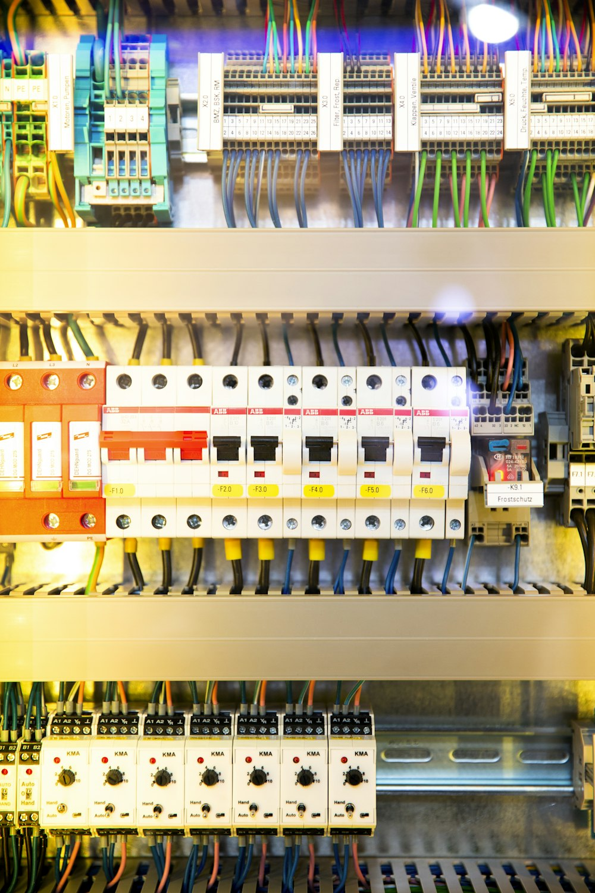

# CARÁTULA DEL CUADERNILLO TÉCNICO

```
╔═══════════════════════════════════════════════════════════════════════════════╗
║          DIRECCIÓN GENERAL DE EDUCACIÓN TÉCNICO PROFESIONAL (ETP)            ║
║                  ESCUELA DE EDUCACIÓN SECUNDARIA TÉCNICA                      ║
║         Especialidad: Electromecánica // Electricidad // Energías             ║
╚═══════════════════════════════════════════════════════════════════════════════╝
```

## DIMENSIONAMIENTO DE CONDUCTORES Y CÁLCULO DE CAÍDA DE TENSIÓN
### Cuadernillo Didáctico de Aprendizaje y Prácticas de Taller
**Normativa de Aplicación:** Reglamentación AEA 90364 • Normas IRAM NM 247-3 / 2178 • IEC 60364


> **Subestación Transformadora de Distribución Eléctrica:**  
> Máquina estática trifásica reductora de Media a Baja Tensión (13.2 kV / 380-220 V). Origen físico de las líneas de alimentación donde se fija la tensión nominal antes de experimentar caídas a lo largo de los conductores.

---

### RÓTULO TÉCNICO NORMALIZADO (IRAM)

| Campo | Información del Proyecto |
|---|---|
| **Espacio Curricular:** | Instalaciones Eléctricas / Electrotecnia Aplicada |
| **Curso y División:** | ...... Año &nbsp; / &nbsp; División: ........................ |
| **Estudiante:** | ........................................................................................ |
| **Docente a Cargo:** | ........................................................................................ |
| **Ciclo Lectivo:** | 202... |
| **Calificación / Estado:** | ........................................................................................ |

---
<div style="page-break-after: always;"></div>


## 1. INTRODUCCIÓN Y FUNDAMENTO FÍSICO

En el diseño y ejecución de instalaciones eléctricas según la reglamentación **AEA 90364** (Asociación Electrotécnica Argentina) y normas internacionales **IEC 60364**, la elección de la sección de los conductores eléctricos **NUNCA** se realiza basándose en un único parámetro.

Todo conductor eléctrico real presenta una oposición física al paso de la corriente eléctrica debida a su resistencia óhmica $R$ y, en corriente alterna de secciones considerables, a su reactancia inductiva $X_L$. 

Cuando circula una corriente de carga $I$, se produce en la línea una pérdida de potencial eléctrico entre el origen (tablero de distribución o medidor) y los bornes del receptor de energía. A esta diferencia de potencial se la denomina **Caída de Tensión ($\Delta U$)**.

### 1.1 ¿Cuáles son las consecuencias de una caída de tensión excesiva?
1. **Pérdida de cupla y sobrecalentamiento en motores eléctricos:** La cupla o torque de arranque de un motor de inducción asincrónico es directamente proporcional al *cuadrado* de la tensión aplicada ($C \propto U^2$). Una caída del 10% reduce el torque de arranque en casi un 20%, dificultando la puesta en marcha y provocando sobreintensidades destructivas.
2. **Disminución severa del flujo luminoso:** En lámparas incandescentes y halógenas, una caída del 5% en la tensión puede disminuir el flujo luminoso hasta un 20%. En luminarias LED y balastos electrónicos modernos, tensiones por debajo del rango nominal provocan parpadeos (*flicker*), reducción de vida útil de los drivers o apagado intempestivo.
3. **Mal funcionamiento de relés, contactores y electrónica:** Contactores industriales pueden vibrar o abrirse si la bobina de retención no recibe la tensión mínima requerida ($U \ge 0.85 \cdot U_n$).
4. **Pérdidas de energía en forma de calor:** El conductor disipa energía por efecto Joule ($P_{pérdida} = I^2 \cdot R$), encareciendo el consumo eléctrico innecesariamente y envejeciendo prematuramente la aislación.

---

## 2. PARÁMETROS QUE DETERMINAN LA RESISTENCIA DEL CONDUCTOR

Según la **Ley de Pouillet**:

$$R = \rho \cdot \frac{L}{S} \quad [\Omega]$$

Donde:
- **$R$**: Resistencia óhmica del conductor (en $\Omega$).
- **$\rho$ (Rho)**: Resistividad eléctrica del material conductor a una temperatura determinada (en $\Omega \cdot \text{mm}^2 / \text{m}$).
- **$L$**: Longitud de la canalización (en metros, $\text{m}$).
- **$S$**: Sección transversal nominal del conductor (en $\text{mm}^2$).

### 2.1 La temperatura de trabajo del conductor
La resistividad de los metales aumenta con la temperatura de acuerdo a la ecuación:

$$\rho_T = \rho_{20} \cdot [1 + \alpha_{20} \cdot (T - 20^\circ\text{C})]$$

Para el cobre electrolítico comercial ($99.9\%$ pureza):
- Coeficiente de temperatura: $\alpha_{20} \approx 0.00393 \ ^\circ\text{C}^{-1}$
- Resistividad a $20^\circ\text{C}$: $\rho_{20} = 0.0178 \approx 0.018 \ \frac{\Omega \cdot \text{mm}^2}{\text{m}}$
- **Resistividad a la temperatura máxima de servicio continuo ($70^\circ\text{C}$ para aislación termoplástica de PVC - IRAM NM 247-3 / IRAM 2178):**
  $$\rho_{70} = 0.0178 \cdot [1 + 0.00393 \cdot (70 - 20)] \approx 0.0213 \approx \mathbf{0.021} \ \frac{\mathbf{\Omega} \cdot \mathbf{mm}^2}{\mathbf{m}}$$
- **Resistividad a la temperatura máxima de servicio continuo ($90^\circ\text{C}$ para aislación termoestable XLPE/EPR):**
  $$\rho_{90} \approx \mathbf{0.023} \ \frac{\mathbf{\Omega} \cdot \mathbf{mm}^2}{\mathbf{m}}$$

> **Criterio Técnico Reglamentario:**  
> En proyectos profesionales y cálculos de seguridad, se debe utilizar la resistividad del material a la temperatura de régimen permanente (**$\rho = 0.021 \ \Omega\cdot\text{mm}^2/\text{m}$ para PVC**), ya que calcular con el valor a $20^\circ\text{C}$ subestima la caída real entre un 15% y un 18%.

---

## 3. FÓRMULAS DE CÁLCULO DE CAÍDA DE TENSIÓN

### 3.1 Circuito Monofásico ($220 \text{ V}$ / $230 \text{ V}$)
En una instalación monofásica, la corriente circula desde el origen hasta la carga por el conductor de fase y retorna íntegramente por el conductor de neutro. Por consiguiente, la longitud total recorrida es el doble de la longitud geométrica de la línea ($2L$).

#### Caída de tensión absoluta ($\Delta U$ en Voltios):
$$\Delta U = 2 \cdot R \cdot I = \frac{2 \cdot \rho \cdot L \cdot I}{S} \quad [\text{V}]$$

Si conocemos la potencia activa monofásica $P$ (en Watts) y el factor de potencia $\cos\varphi$:
Como $I = \frac{P}{U_n \cdot \cos\varphi}$, reemplazando se obtiene:
$$\Delta U = \frac{2 \cdot \rho \cdot L \cdot P}{U_n \cdot S \cdot \cos\varphi} \cdot \cos\varphi = \frac{2 \cdot \rho \cdot L \cdot P}{U_n \cdot S} \quad [\text{V}]$$

#### Caída de tensión relativa porcentual ($\Delta U\%$):
$$\Delta U\% = \frac{\Delta U}{U_n} \cdot 100\% = \frac{2 \cdot \rho \cdot L \cdot I}{U_n \cdot S} \cdot 100\%$$

Para $U_n = 220\text{ V}$ y conductor de cobre a $70^\circ\text{C}$ ($\rho = 0.021$):
$$\Delta U\% = \frac{2 \cdot 0.021 \cdot L \cdot I}{220 \cdot S} \cdot 100\% = \frac{0.0191 \cdot L \cdot I}{S}$$

#### Despeje de la sección mínima necesaria ($S_{mín}$):
$$S_{mín} \ge \frac{2 \cdot \rho \cdot L \cdot I}{\Delta U_{adm}} \quad [\text{mm}^2]$$
O en función de la caída porcentual admisible ($\Delta U\%_{adm}$):
$$S_{mín} \ge \frac{200 \cdot \rho \cdot L \cdot I}{U_n \cdot \Delta U\%_{adm}} \quad [\text{mm}^2]$$

---

### 3.2 Circuito Trifásico Equilibrado ($380 \text{ V}$ / $400 \text{ V}$)
En un sistema trifásico tetrapolar con cargas perfectamente equilibradas, la suma vectorial de las tres corrientes de fase es nula en el centro de estrella, por lo que por el conductor neutro no circula corriente ($I_N = 0$). La caída de tensión entre fases (tensión de línea) se deduce vectorialmente:

$$\Delta U = \sqrt{3} \cdot R_{fase} \cdot I = \sqrt{3} \cdot \frac{\rho \cdot L}{S} \cdot I \quad [\text{V}]$$

#### Caída de tensión en función de la potencia trifásica activa $P$ (en Watts):
Recordando que para un sistema trifásico:
$$P = \sqrt{3} \cdot U_n \cdot I \cdot \cos\varphi \implies I \cdot \cos\varphi = \frac{P}{\sqrt{3} \cdot U_n}$$

Reemplazando en la expresión de caída:
$$\Delta U = \frac{\rho \cdot L \cdot P}{U_n \cdot S} \quad [\text{V}]$$

#### Caída de tensión relativa porcentual ($\Delta U\%$):
$$\Delta U\% = \frac{\Delta U}{U_n} \cdot 100\% = \frac{\sqrt{3} \cdot \rho \cdot L \cdot I}{U_n \cdot S} \cdot 100\% = \frac{\rho \cdot L \cdot P \cdot 100}{U_n^2 \cdot S}$$

Para $U_n = 380\text{ V}$ y conductor de cobre a $70^\circ\text{C}$ ($\rho = 0.021$):
$$\Delta U\% = \frac{\sqrt{3} \cdot 0.021 \cdot L \cdot I}{380 \cdot S} \cdot 100\% = \frac{0.00957 \cdot L \cdot I}{S}$$

#### Despeje de la sección mínima necesaria ($S_{mín}$):
$$S_{mín} \ge \frac{\sqrt{3} \cdot \rho \cdot L \cdot I}{\Delta U_{adm}} = \frac{100 \cdot \sqrt{3} \cdot \rho \cdot L \cdot I}{U_n \cdot \Delta U\%_{adm}} \quad [\text{mm}^2]$$
O en función de la potencia activa:
$$S_{mín} \ge \frac{100 \cdot \rho \cdot L \cdot P}{U_n^2 \cdot \Delta U\%_{adm}} \quad [\text{mm}^2]$$

---

## 4. LÍMITES MÁXIMOS PERMITIDOS SEGÚN REGLAMENTACIÓN AEA 90364

La reglamentación de la **Asociación Electrotécnica Argentina (AEA 90364 Parte 7 - Sección 771 y 770)** estipula los siguientes valores máximos de caída de tensión entre los bornes de salida del medidor de energía y cualquier punto de utilización:

| Tipo de Circuito / Sector de la Instalación | $\Delta U\%$ Máx. Admisible | $\Delta U$ en $220\text{V}$ | $\Delta U$ en $380\text{V}$ |
|---|:---:|:---:|:---:|
| **Línea Principal** (Medidor a Tablero Principal) | **$1.0\%$** | $2.20\text{ V}$ | $3.80\text{ V}$ |
| **Circuitos Terminales de Iluminación** | **$3.0\%$** | $6.60\text{ V}$ | $11.40\text{ V}$ |
| **Circuitos Terminales de Tomas de Uso General / Especial** | **$5.0\%$** | $11.00\text{ V}$ | $19.00\text{ V}$ |
| **Circuitos de Fuerza Motriz / Motores (Régimen Permanente)** | **$5.0\%$** | $11.00\text{ V}$ | $19.00\text{ V}$ |
| **Transitorio de Arranque de Motores** | **$10\% \text{ a } 15\%$** | $22.0 - 33.0\text{ V}$ | $38.0 - 57.0\text{ V}$ |

> **IMPORTANTE - REGLA DE LAS DOS CONDICIONES OBLIGATORIAS:**  
> La sección comercial elegida para cualquier conductor debe satisfacer **SIMULTÁNEAMENTE**:
> 1. **Criterio Térmico (Corriente Admisible):**  
>    $$I_b \le I_n \le I_z$$  
>    Donde $I_b$ es la corriente de proyecto, $I_n$ el calibre de la protección termomagnética e $I_z$ la corriente máxima admisible por el conductor (según tablas IRAM corregida por temperatura y agrupamiento).
> 2. **Criterio de Caída de Tensión:**  
>    $$\Delta U\% \le \Delta U\%_{adm}$$  
>  
> **Se adopta siempre la sección mayor resultante de comparar ambos criterios.**

---

## 5. TABLA DE SECCIONES NORMALIZADAS Y CORRIENTES ADMISIBLES
Conductores de cobre normalizados según **IRAM NM 247-3** (aislación de PVC $70^\circ\text{C}$ en cañería embutida en mampostería - Método B1) e **IRAM 2178** (subterráneo directamente enterrado o en trinchera):

| Sección Nominal ($S$) | $I_z$ Cañería 2 cond. (Monof.) | $I_z$ Cañería 3 cond. (Trif.) | $I_z$ Subterráneo enterrado (Trif.) | Resistencia $R$ a $20^\circ\text{C}$ |
|:---:|:---:|:---:|:---:|:---:|
| **$1.5 \text{ mm}^2$** | $15.0\text{ A}$ | $13.5\text{ A}$ | — | $12.1 \ \Omega/\text{km}$ |
| **$2.5 \text{ mm}^2$** | $21.0\text{ A}$ | $18.5\text{ A}$ | $36\text{ A}$ | $7.41 \ \Omega/\text{km}$ |
| **$4 \text{ mm}^2$** | $28.0\text{ A}$ | $25.0\text{ A}$ | $47\text{ A}$ | $4.61 \ \Omega/\text{km}$ |
| **$6 \text{ mm}^2$** | $36.0\text{ A}$ | $32.0\text{ A}$ | $59\text{ A}$ | $3.08 \ \Omega/\text{km}$ |
| **$10 \text{ mm}^2$** | $50.0\text{ A}$ | $44.0\text{ A}$ | $79\text{ A}$ | $1.83 \ \Omega/\text{km}$ |
| **$16 \text{ mm}^2$** | $66.0\text{ A}$ | $58.0\text{ A}$ | $102\text{ A}$ | $1.15 \ \Omega/\text{km}$ |
| **$25 \text{ mm}^2$** | $88.0\text{ A}$ | $77.0\text{ A}$ | $133\text{ A}$ | $0.727 \ \Omega/\text{km}$ |
| **$35 \text{ mm}^2$** | $109.0\text{ A}$ | $96.0\text{ A}$ | $159\text{ A}$ | $0.524 \ \Omega/\text{km}$ |
| **$50 \text{ mm}^2$** | $131.0\text{ A}$ | $117.0\text{ A}$ | $188\text{ A}$ | $0.387 \ \Omega/\text{km}$ |
| **$70 \text{ mm}^2$** | $166.0\text{ A}$ | $149.0\text{ A}$ | $232\text{ A}$ | $0.268 \ \Omega/\text{km}$ |
| **$95 \text{ mm}^2$** | $202.0\text{ A}$ | $180.0\text{ A}$ | $280\text{ A}$ | $0.193 \ \Omega/\text{km}$ |

---

## 6. EJEMPLOS PRÁCTICOS RESUELTOS PASO A PASO

### Ejemplo 1: Circuito terminal monofásico de iluminación de un patio exterior
**Enunciado:**  
Se debe alimentar una columna de reflectores LED en el patio de la escuela. La potencia total instalada es de $1100\text{ W}$ en $220\text{ V}$, $\cos\varphi = 0.95$. La distancia desde el Tablero Seccional de Mantenimiento hasta la columna es de $45\text{ metros}$. El cable utilizado es de cobre con aislación de PVC canalizado en cañería.
Determine la sección reglamentaria del conductor verificando caída de tensión y corriente admisible.

**Resolución:**
1. **Cálculo de la corriente de proyecto ($I_b$):**
   $$I_b = \frac{P}{U_n \cdot \cos\varphi} = \frac{1100\text{ W}}{220\text{ V} \cdot 0.95} = \frac{1100}{209} \approx 5.26\text{ A}$$
2. **Determinación del límite de caída de tensión admisible:**  
   Por tratarse de un circuito de **iluminación**, según AEA 90364 la caída máxima permitida es del **$3\%$**:
   $$\Delta U_{adm} = 220\text{ V} \cdot 0.03 = 6.60\text{ V}$$
3. **Cálculo de la sección teórica mínima por caída de tensión ($\rho_{70} = 0.021$):**
   $$S_{mín} = \frac{2 \cdot \rho \cdot L \cdot I_b}{\Delta U_{adm}} = \frac{2 \cdot 0.021 \cdot 45\text{ m} \cdot 5.26\text{ A}}{6.60\text{ V}} = \frac{9.941}{6.60} \approx 1.506\text{ mm}^2$$
4. **Selección de la sección comercial normalizada:**  
   La sección comercial inmediata superior es **$2.5\text{ mm}^2$** (además, la AEA exige como sección mínima para líneas seccionales y circuitos de tomas $2.5\text{ mm}^2$, y si bien para iluminación terminal permite $1.5\text{ mm}^2$, aquí $1.506 > 1.5$).
5. **Verificación con la sección adoptada ($S = 2.5\text{ mm}^2$):**
   $$\Delta U_{real} = \frac{2 \cdot 0.021 \cdot 45 \cdot 5.26}{2.5} = 3.977\text{ V}$$
   $$\Delta U\% = \frac{3.977\text{ V}}{220\text{ V}} \cdot 100\% = \mathbf{1.81\%} \le 3\% \quad \checkmark \text{ CUMPLE}$$
6. **Verificación térmica:**  
   Para $2.5\text{ mm}^2$ en cañería, $I_z = 21\text{ A}$.  
   Con un interruptor termomagnético de $I_n = 10\text{ A}$ (o $16\text{ A}$):
   $$I_b (5.26\text{ A}) \le I_n (10\text{ A}) \le I_z (21\text{ A}) \quad \checkmark \text{ CUMPLE}$$
**Conclusión:** Se adopta conductor de cobre de **$2 \times 2.5\text{ mm}^2 + 2.5\text{ mm}^2 \text{ PE}$**.

---

### Ejemplo 2: Alimentación trifásica de una bomba de agua sumergible distante
**Enunciado:**  
En el campo de deportes de la escuela técnica se ubica una electrobomba sumergible trifásica de $7.5\text{ kW}$ ($10\text{ HP}$ aprox.), $380\text{ V}$, $\cos\varphi = 0.85$, rendimiento $\eta = 0.88$.  
La distancia desde el Tablero General hasta la caseta de bombeo es de $140\text{ metros}$ en tendido subterráneo con cable tipo IRAM 2178 (cobre, aislamiento PVC).  
Determine la sección comercial necesaria.

**Resolución:**
1. **Cálculo de la potencia eléctrica consumida de la red ($P_{in}$):**
   $$P_{in} = \frac{P_{mec}}{\eta} = \frac{7500\text{ W}}{0.88} \approx 8522.7\text{ W}$$
2. **Cálculo de la corriente nominal de línea ($I_b$):**
   $$I_b = \frac{P_{in}}{\sqrt{3} \cdot U_n \cdot \cos\varphi} = \frac{8522.7}{\sqrt{3} \cdot 380 \cdot 0.85} = \frac{8522.7}{559.45} \approx 15.23\text{ A}$$
3. **Límite reglamentario admisible:**  
   Para fuerza motriz en régimen permanente, el límite es del **$5\%$**:
   $$\Delta U_{adm} = 380\text{ V} \cdot 0.05 = 19.00\text{ V}$$
4. **Cálculo de la sección teórica mínima ($S_{mín}$):**
   $$S_{mín} = \frac{\sqrt{3} \cdot \rho \cdot L \cdot I_b}{\Delta U_{adm}} = \frac{1.732 \cdot 0.021 \cdot 140 \cdot 15.23}{19.00} = \frac{77.56}{19.00} \approx 4.08\text{ mm}^2$$
5. **Elección de la sección comercial:**  
   Como $4.08\text{ mm}^2 > 4.0\text{ mm}^2$, la sección comercial normalizada inmediata que garantiza cumplir la caída reglamentaria es **$6\text{ mm}^2$**.
6. **Recálculo de la caída real con $S = 6\text{ mm}^2$:**
   $$\Delta U_{real} = \frac{1.732 \cdot 0.021 \cdot 140 \cdot 15.23}{6} = 12.93\text{ V}$$
   $$\Delta U\% = \frac{12.93}{380} \cdot 100\% = \mathbf{3.40\%} \le 5\% \quad \checkmark \text{ CUMPLE HOLGADAMENTE}$$
7. **Verificación térmica:**  
   Un cable IRAM 2178 de $4 \times 6\text{ mm}^2$ enterrado soporta $I_z \approx 59\text{ A}$.  
   Protección termomagnética curva D de $I_n = 20\text{ A}$ (o $25\text{ A}$):
   $$I_b (15.23\text{ A}) \le I_n (20\text{ A}) \le I_z (59\text{ A}) \quad \checkmark \text{ CUMPLE}$$
**Conclusión:** Se instala cable subterráneo tetrapolar de **$4 \times 6\text{ mm}^2$**. (Nótese que por corriente admisible bastaría con $2.5\text{ mm}^2$, pero por distancia de 140m la caída de tensión obliga a elevar la sección a $6\text{ mm}^2$).

---

### Ejemplo 3: Alimentación monofásica a un torno del taller mecánico
**Enunciado:**  
Un torno monofásico de $2.2\text{ kW}$ ($220\text{ V}$, $\cos\varphi = 0.82$) está instalado a $30\text{ metros}$ del tablero seccional. El cable es unipolar de cobre en cañería.  
Verificar si un conductor de sección $2.5\text{ mm}^2$ cumple con la normativa de caída de tensión ($\le 5\%$).

**Resolución:**
1. **Corriente de la máquina:**
   $$I_b = \frac{2200}{220 \cdot 0.82} = \frac{2200}{180.4} \approx 12.20\text{ A}$$
2. **Caída de tensión calculada para $S = 2.5\text{ mm}^2$:**
   $$\Delta U = \frac{2 \cdot 0.021 \cdot 30 \cdot 12.20}{2.5} = \frac{15.372}{2.5} = 6.15\text{ V}$$
3. **Caída porcentual:**
   $$\Delta U\% = \frac{6.15\text{ V}}{220\text{ V}} \cdot 100\% = \mathbf{2.80\%}$$
4. **Conclusión y dictamen:**  
   Como $2.80\% \le 5.0\%$, el conductor de $2.5\text{ mm}^2$ cumple reglamentariamente con la caída de tensión.  
   Térmicamente, $2.5\text{ mm}^2$ soporta $21\text{ A} > 12.20\text{ A}$. Se protege con termomagnética de $16\text{ A}$.

---

## 7. GUÍA DE EJERCITACIÓN PRÁCTICA PARA EL ESTUDIANTE

### Ejercicio 1 (Nivel Inicial - Monofásico Básico)
Un circuito de iluminación para dos aulas contiguas transporta una corriente total de $8.5\text{ A}$ a $220\text{ V}$. La distancia desde el tablero secundario hasta la última luminaria es de $28\text{ metros}$.
- a) Calcule la caída de tensión en Volts y en porcentaje si se utiliza cable de $1.5\text{ mm}^2$ de cobre ($\rho = 0.021$).
- b) ¿Cumple con la norma AEA 90364 para circuitos de iluminación? Justifique numéricamente.
- *Respuesta orientativa:* $\Delta U = 6.66\text{ V}$ ($\Delta U\% = 3.03\% > 3\% \implies$ NO cumple por poco. Se debe adoptar $2.5\text{ mm}^2$, con el cual $\Delta U\% = 1.82\%$).

---

### Ejercicio 2 (Nivel Inicial - Fuerza Motriz Monofásica)
Se debe conectar un compresor de aire monofásico de $3\text{ kW}$ ($220\text{ V}$, $\cos\varphi = 0.88$) ubicado en el fondo del pañol a $52\text{ metros}$ del tablero general.
- a) Calcule la corriente nominal $I_b$.
- b) Determine la sección mínima necesaria para no superar el $5\%$ de caída de tensión.
- c) Adopte la sección comercial normalizada y verifique la caída porcentual real obtenida.

---

### Ejercicio 3 (Nivel Intermedio - Trifásico Equilibrado)
Un horno cerámico trifásico resistivo puro ($\cos\varphi = 1.0$) de $18\text{ kW}$ se alimenta a $380\text{ V}$. La longitud de la línea en bandeja perforada es de $65\text{ metros}$.
- a) Calcule la corriente por fase.
- b) Considerando un límite de caída de tensión del $3\%$, calcule la sección mínima teórica.
- c) Seleccione la sección comercial correspondiente y verifique que la capacidad de corriente sea adecuada.

---

### Ejercicio 4 (Nivel Intermedio - Tablero Seccional de Taller)
Desde el Tablero Principal (junto al medidor) hasta el Tablero Seccional del Taller de Electromecánica hay una distancia de $85\text{ metros}$. La potencia simultánea máxima estimada es de $25\text{ kW}$ trifásica en $380\text{ V}$, con factor de potencia medio $\cos\varphi = 0.85$.
- La reglamentación exige que la línea principal o seccional general tenga una caída no mayor al **$1.5\%$** (o $1\%$ si es línea principal de acometida).
- Determine la sección comercial del conductor subterráneo de cobre que garantice $\Delta U\% \le 1.5\%$.

---

### Ejercicio 5 (Nivel Avanzado - Verificación Completa y Disparo de Protección)
Una línea monofásica de $220\text{ V}$ alimenta un motor de $1.5\text{ kW}$ ($\cos\varphi = 0.80$, $\eta = 0.82$) situado a $95\text{ metros}$. El instalador utilizó erróneamente cable de $1.5\text{ mm}^2$.
- a) Calcule la caída de tensión en régimen nominal.
- b) Durante el arranque, el motor absorbe una corriente equivalente a $5.5$ veces la corriente nominal ($I_{arr} = 5.5 \cdot I_n$). ¿Cuál será la tensión en bornes del motor durante el instante del arranque?
- c) ¿Podrá el motor arrancar con seguridad o qué consecuencias técnicas experimentará?
- d) Proponga la sección correcta de conductor para solucionar el problema.

---

### Ejercicio 6 (Nivel Avanzado - Comparativa Económica Cobre vs. Aluminio)
Para alimentar un predio agrícola de la escuela técnica a $210\text{ metros}$ de distancia se requiere una carga trifásica de $35\text{ A}$ a $380\text{ V}$ ($\Delta U\%_{adm} = 5\%$).
- a) Calcule la sección requerida si se utiliza cable subterráneo de Cobre ($\rho = 0.021$).
- b) Calcule la sección requerida si se utiliza cable preensamblado de Aluminio ($\rho_{70} = 0.034 \ \Omega\cdot\text{mm}^2/\text{m}$).
- c) Explique la ventaja técnico-económica del aluminio en tendidos de gran longitud.

---

## 8. PLANTILLA DE AUTOEVALUACIÓN Y REGISTRO DE TRABAJO

| N° Ejercicio | $I_b$ calculada | $S_{teórica}$ | $S_{adoptada}$ | $\Delta U\%$ final | Dictamen (Cumple / No cumple) | Firma Docente |
|:---:|:---:|:---:|:---:|:---:|:---:|:---:|
| 1 | | | | | | |
| 2 | | | | | | |
| 3 | | | | | | |
| 4 | | | | | | |
| 5 | | | | | | |
| 6 | | | | | | |

---

*Material didáctico desarrollado para el fortalecimiento de la Educación Técnico Profesional (ETP).*
